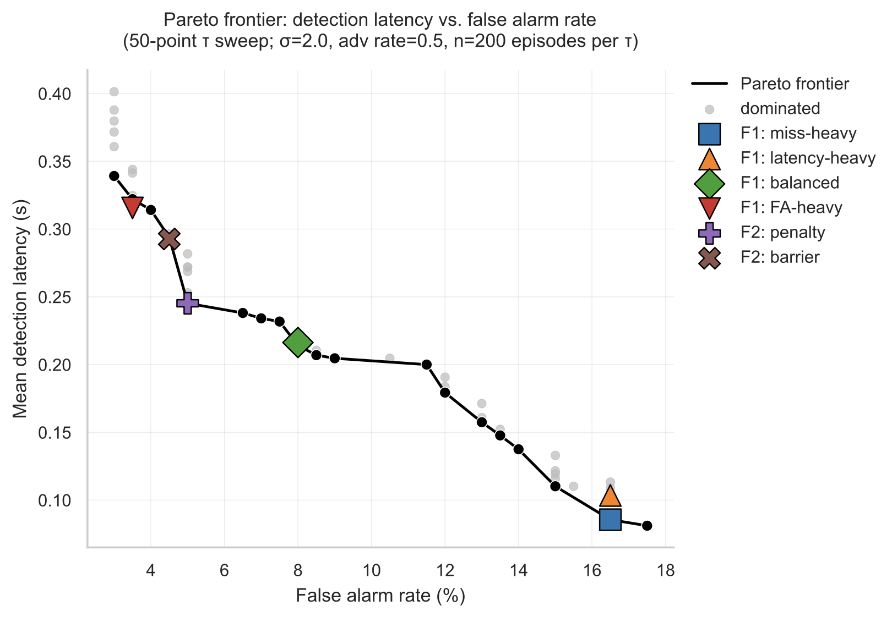

<div align="center">

# Optimizing Active Inference Agents for Robustness to Adversarial Behavior in Traffic Interactions

</div>

> When a self-driving car sees another driver flip on their yield indicator while accelerating into the intersection, who should it trust — the signal, or the motion?

This project formulates that question as an optimization problem. A naive active-inference agent that trusts yield signals collides in **100% of deterministic adversarial encounters**. Adding a single-parameter inconsistency detector eliminates the failure mode and matches a ground-truth oracle in collision prevention.


*Left: a naive agent trusts A's yield signal — even as A accelerates into the intersection — and collides. Right: the same scenario with an inconsistency detector; the score climbs as the signal contradicts A's motion, B brakes, and yields safely. Both panels use identical initial conditions and the same adversary.*

---

## What's here

A complete study of detection-threshold selection in a simulated two-agent intersection, framed three ways:

- **F1 — Scalarized:** weighted-sum loss over latency, false alarms, and missed detections, solved by golden-section search
- **F2 — Constrained:** minimize latency subject to a false alarm bound, solved by both quadratic penalty and log-barrier outer-loop methods
- **F3 — Multi-objective:** 50-point Pareto sweep over (latency, false-alarm rate, collision rate)

Across all three, the optimal threshold varies by **20× across loss weights** and **25× across adversarial-prior assumptions**, meaning trust calibration isn't a tunable hyperparameter — it's a design decision tied to the deployment environment.

## Key results

**Detection prevents 100% of preventable collisions.** At observation noise σ = 2.0 m/s², a naive agent collides on 4.0% of episodes, the optimized detector collides on 1.5%, and a ground-truth oracle collides on 1.5%. The residual 1.5% reflects scenarios where even perfect knowledge can't brake in time.

**Five of six optimization-method optima land on the empirical Pareto frontier**, validating that the formulations are well-posed:



**Constrained formulation beats weighted-sum proxies.** At a fixed false-alarm bound of 5%, the F2 penalty method achieves 0.245 s latency versus F1's nearest weighted-sum analog at 0.316 s — empirical evidence for using explicit constraints when a hard operational bound exists.

**Penalty and barrier methods bracket the constraint boundary** as theory predicts: penalty converges to FA = 5.00% (exactly at the bound), barrier converges to FA = 4.50% (strictly feasible).

**Results are robust.** Across 10 random seeds, the optimal τ varies by less than 0.001 for every method tested. Numbers reported here are not Monte Carlo artifacts.

## Paper

Full writeup with system model, optimization formulations, sensitivity analyses, and ablations:

📄 **[Final paper (PDF)](paper.pdf)** — IEEE 2-column, 5 pages

## Tech stack

- Python 3.11+
- NumPy, matplotlib, seaborn for analysis and figures
- Pillow for the animation GIF
- No deep learning, no large dependencies — everything runs on CPU in under a minute per experiment

## Repository layout

```
.
├── README.md                          project overview + reproduce instructions
├── paper.pdf                          final write-up
├── episode_comparison.gif             README animation
├── requirements.txt                   Python dependencies
├── LICENSE                            MIT
│
├── src/                               library code
│   ├── agent.py                       kinematic agent state
│   ├── simulator.py                   2-agent intersection sim
│   ├── beliefs.py                     Bayesian belief update over intent
│   ├── objective.py                   EFE-style action selection
│   ├── adversarial.py                 honest / deceptive other-agent policies
│   ├── detection.py                   inconsistency score + threshold detector
│   └── evaluation.py                  harness that turns τ into aggregate metrics
│
├── experiments/                       one runnable script per experiment
│   ├── optimize_threshold.py          F1: 1-D τ optimization (golden section)
│   ├── constrained_optimization.py    F2: penalty + log-barrier
│   ├── pareto_analysis.py             F3: Pareto sweep
│   ├── sensitivity_sweep.py           noise / adv-rate / seed-variance / oracle
│   └── extended_experiments.py        seed variance per method + gating ablation
│
├── analysis/                          figures (read results/, write PNG + PDF)
│   ├── plot_convergence.py            F1/F2 convergence
│   ├── plot_pareto.py                 F3 frontier
│   └── plot_sensitivity.py            sensitivity figure
│
└── results/                           generated outputs (committed for reproducibility)
    ├── optimize_threshold/            F1 result.json + figures, per weight setting
    ├── constrained_optimization/      F2 result.json + figures
    ├── pareto_analysis/               F3 result.json + frontier figure
    ├── sensitivity/                   sensitivity sweeps
    └── rigor/                         seed variance + ablation
```

## Running it

```bash
# Install dependencies
pip install numpy matplotlib seaborn pillow pyyaml

# Run individual experiments
python -m experiments.optimize_threshold        # F1
python -m experiments.constrained_optimization  # F2
python -m experiments.pareto_analysis           # F3
python -m experiments.sensitivity_sweep         # Sensitivity + oracle baseline
python -m experiments.extended_experiments      # Seed variance + ablations

# Generate figures
python -m analysis.plot_pareto
python -m analysis.plot_convergence
python -m analysis.plot_sensitivity
python -m analysis.animate_episodes             # Generates the GIF
```

Each experiment writes results to `results/<experiment_name>/result.json`. Plotting scripts read those JSON files and write `.png`/`.pdf` figures next to them.

## Background

This project builds on recent active-inference models of road-user interaction by Schumann et al. (2026), which show that misleading communication can produce unsafe outcomes — and treat that observation as a limitation. The contribution here is to make that failure mode the explicit subject of optimization, with three formulations, three measurable metrics, and a Pareto-validated cross-comparison.

References for the techniques used:
- Kochenderfer & Wheeler, *Algorithms for Optimization* (MIT Press, 2019) — golden-section, penalty/barrier, Pareto
- Nocedal & Wright, *Numerical Optimization* (Springer, 2006) — penalty methods
- Boyd & Vandenberghe, *Convex Optimization* (Cambridge, 2004) — barrier methods
- Friston, "The free-energy principle" *Nat Rev Neurosci* (2010) — active inference foundations

## License

[MIT](LICENSE)

## Author

**Lea M. Hadzic** — Stanford Computer Science  
Final project for CS 361 / AA 222 (Engineering Design Optimization), Spring 2026.
