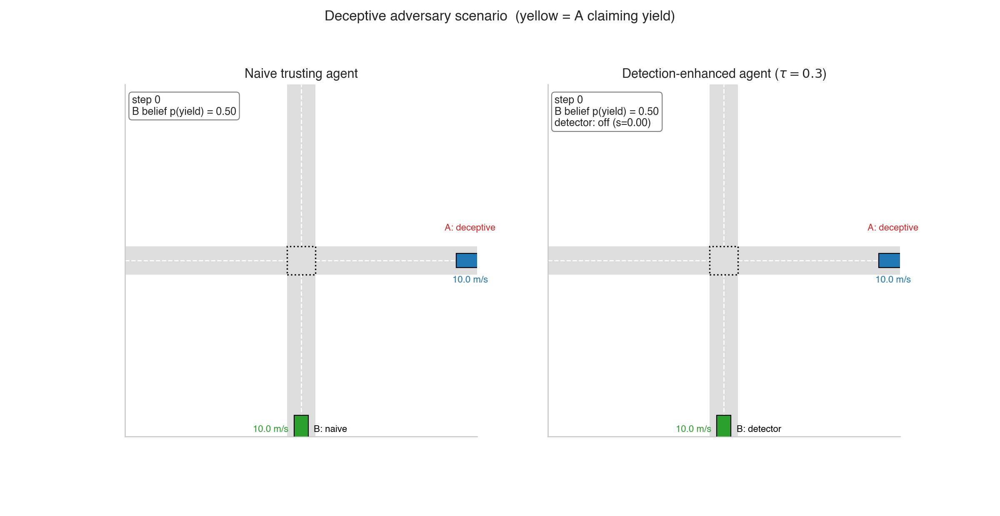

<div align="center">

# Optimizing Active Inference Agents for Robustness to Adversarial Behavior in Traffic Interactions

</div>

_When a self-driving car sees another driver flip on their yield indicator while accelerating into the intersection, who should it trust — the signal, or the motion?_

This project formulates that question as an optimization problem. A naive active-inference agent that trusts yield signals collides in **100% of deterministic adversarial encounters**. Adding a single-parameter inconsistency detector eliminates the failure mode and matches a ground-truth oracle in collision prevention.



*Left: a naive agent trusts A's yield signal — even as A accelerates into the intersection — and collides. Right: the same scenario with an inconsistency detector; the score climbs as the signal contradicts A's motion, B brakes, and yields safely. Both panels use identical initial conditions and the same adversary.*

---

## What's here

A two-agent uncontrolled-intersection simulator, an EFE-style decision-making
policy with a Bayesian belief over the other agent's intent, and a detector
that watches for inconsistencies between an emitted yield signal and the
observed kinematics. The detector has one design knob — the threshold **τ** —
and the project optimizes it under three formulations:

| # | Formulation | Optimizer |
|---|---|---|
| **F1** | Scalarized weighted loss over latency / false-alarm / miss | Golden-section search |
| **F2** | Min-latency subject to FA ≤ FA<sub>max</sub> | Quadratic penalty + log barrier |
| **F3** | Pareto frontier over (latency, FA, collision rate) | 50-point sweep, dominance filter |

Plus a sensitivity study (observation noise, adversarial rate, seed variance,
oracle comparison) and a conflict-phase-gating ablation.

_This project builds on recent active-inference models of road-user interaction by Schumann et al. (2026), which show that misleading communication can produce unsafe outcomes — and treat that observation as a limitation._

## Key results

* **Detection prevents 100% of preventable collisions.** At observation noise σ = 2.0 m/s², a naive agent collides on 4.0% of episodes, the optimized detector collides on 1.5%, and a ground-truth oracle collides on 1.5%. The residual 1.5% reflects scenarios where even perfect knowledge can't brake in time.

* **Five of six optimization-method optima land on the empirical Pareto frontier**, validating that the formulations are well-posed.

* **Constrained formulation beats weighted-sum proxies.** At a fixed false-alarm bound of 5%, the F2 penalty method achieves 0.245 s latency versus F1's nearest weighted-sum analog at 0.316 s — empirical evidence for using explicit constraints when a hard operational bound exists.

* **Penalty and barrier methods bracket the constraint boundary** as theory predicts: penalty converges to FA = 5.00% (exactly at the bound), barrier converges to FA = 4.50% (strictly feasible).

## Tech stack

- `Python 3.10+`
- [`numpy`](https://numpy.org) + [`scipy`](https://scipy.org) — numerical primitives, golden-section search
- [`matplotlib`](https://matplotlib.org) + [`seaborn`](https://seaborn.pydata.org) — figures

CPU only — no GPU, no ML framework, no JAX/PyTorch. The full experiment grid runs in a few minutes on a laptop.

## Repository layout

```
.
├── README.md                          project overview + reproduce instructions
├── episode_comparison.gif             README animation
├── requirements.txt                   Python dependencies
├── LICENSE                            MIT
│
├── src/                               library code
│   ├── agent.py                       kinematic agent state
│   ├── simulator.py                   2-agent intersection sim
│   ├── beliefs.py                     Bayesian belief update over intent
│   ├── objective.py                   EFE-style action selection
│   ├── adversarial.py                 honest / deceptive other-agent policies
│   ├── detection.py                   inconsistency score + threshold detector
│   └── evaluation.py                  harness that turns τ into aggregate metrics
│
├── experiments/                       one runnable script per experiment
│   ├── optimize_threshold.py          F1: 1-D τ optimization (golden section)
│   ├── constrained_optimization.py    F2: penalty + log-barrier
│   ├── pareto_analysis.py             F3: Pareto sweep
│   ├── sensitivity_sweep.py           noise / adv-rate / seed-variance / oracle
│   └── extended_experiments.py        seed variance per method + gating ablation
│
└── results/                           
    ├── optimize_threshold/            F1 result.json 
    ├── constrained_optimization/      F2 result.json
    ├── pareto_analysis/               F3 result.json
    ├── sensitivity/                   sensitivity sweeps
    └── rigor/                         seed variance + ablation
```

## Running it

Setup once:

```bash
python -m venv .venv
source .venv/bin/activate
pip install -r requirements.txt
```

Run the experiments — each writes a `result.json` into `results/`:

```bash
python -m experiments.optimize_threshold        # F1
python -m experiments.constrained_optimization  # F2
python -m experiments.pareto_analysis           # F3  (overlays F1+F2 optima — run those first)
python -m experiments.sensitivity_sweep         # noise / adv-rate / seed / oracle sweeps
python -m experiments.extended_experiments      # seed variance per method + gating ablation
```

## License

MIT — see [LICENSE](LICENSE).
